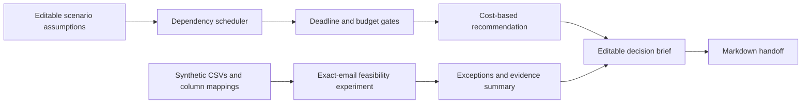

# Day One — Acquisition Discovery Studio

A portfolio prototype that turns a fictional pharmaceutical acquisition into an inspectable integration decision. Compare scenarios, test a narrow data assumption, and export a brief with executable workstreams.

## Run

Python 3 and a modern browser:

```sh
python3 serve.py
```

Open http://127.0.0.1:8770. No packages, API keys, AI services, or external libraries required. `index.html` can also be opened directly. Data processing stays in the browser; nothing is uploaded. Inputs are held in memory and reset on reload.

## Five-minute walkthrough

1. Start at 120 days, quality 70, interface availability 30 days, budget $550,000. The model selects migration: 108 days and $551,000 modeled 12-month cost ($488,000 launch investment).
2. Click **What if launch moves 30 days earlier?** Migration misses the deadline; the model selects the bridge at 57 days. Inspect the critical path and workstream exit criteria.
3. Inspect **Test the data** and run the supplied synthetic extracts. Review exact-email match candidates, duplicate identities, permission conflicts, missing matches and malformed records. Change column mappings or upload your own synthetic CSVs.
4. Open **Prepare the handoff**, edit the outcome and stakeholder questions, and export the decision brief. It includes current assumptions, alternatives, data-experiment summary, dependency-linked workstreams and acceptance criteria.
5. Reduce the launch deadline to 30 days. No option is feasible: the model explicitly asks for reframing.

## Decision model

Hard gates: readiness <= launch deadline and launch investment <= launch budget. Among feasible options, choose lowest modeled 12-month cost. If none qualify, recommend no option.

A directed acyclic graph schedules tasks as early as dependencies permit. One critical path is highlighted, including when multiple paths tie. Calendar days assume parallel teams with no resource contention. Source quality changes profiling/reconciliation durations. Interface availability affects the two paths requiring a new interface.

Launch investment = base cost + ceil(readiness days / 7) × weekly team cost. Twelve-month total adds 12 × monthly transition operations + a future consolidation allowance. Costs and durations are fictional assumptions, exposed in the app. This is a deterministic sensitivity model, not an ROI, compliance, or probabilistic forecast.

## Data experiment

CSV parser supports quoted fields, quoted newlines, escaped quotes, BOM and CRLF. Column mapping requires ID, email and permission. Limits: 1 MB and 5,000 rows per file.

Matching trims and lowercases email. It excludes malformed records, duplicate emails and repeated IDs from automatic candidate matching. Only unambiguous pairs are listed. Permission must be `yes`, `no`, or `unknown`; conflicts and non-affirmative values need review. Even a yes/yes match is only a candidate. A single field cannot establish lawful use, channel, scope, jurisdiction or transferability. No fuzzy matching, identity verification, record merging or communication is performed.

Coverage denominator is all acquired rows, including invalid and duplicate records. Exception counts are events and can include multiple events for a record. The source-quality slider is an assumption, independent of measured email-match coverage. Exports contain raw exception records only when explicitly requested; the executive brief excludes them.

## Scope and decision gates

Northstar and Luma are fictional. Sample records use reserved `.test` addresses. Do not substitute real customer or patient records for the sample.

Patient services, pharmacovigilance integration, safety-case migration and regulatory submissions are excluded unless scope is explicitly expanded. A launch decision requires business, product-line, architecture, security/privacy and operational review. No production integration or regulatory assessment is supplied.

Discovery frames the recommendation and evidence; digital leads take sequencing forward, while product teams validate estimates and own implementation. The prototype does not claim stakeholder validation has occurred.

## Architecture



- `engine.js`: pure scheduling, cost, CSV and reconciliation functions; shared with tests.
- `app.js`: local UI state, graphs, evidence inspection and export.
- `index.html`, `style.css`: responsive interface and three actual workspace views.
- `serve.py`: loopback-only static server.

## Verify

```sh
node --test engine.test.js
node --check app.js
```

## Design decisions

- Deterministic rules instead of a simulated AI: make the recommendation reproducible and assumptions reviewable. AI brief assistance could be added later with source attribution and evaluation.
- A deliberately narrow CSV spike instead of invented enterprise connectors: prove one uncertainty, expose failures, and avoid implying live platform access.
- No persistence or analytics: keep the prototype self-contained and avoid retaining uploaded records.
- Native bars and timeline buttons: keyboard-operable, numerical labels, no CDN dependency. Chart colors are reinforced with text and critical-path descriptions.
